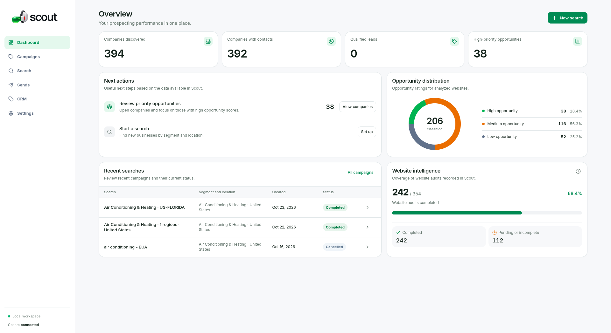

<div align="center">

**English** · [Português](README.pt-BR.md)

<picture>
  <source media="(prefers-color-scheme: dark)" srcset="public/assets/scout-logo-white.png">
  <source media="(prefers-color-scheme: light)" srcset="public/assets/scout-logo-black.png">
  
</picture>

### Find businesses. Discover opportunities. Start conversations.

A local-first, single-user workspace for B2B prospecting: discover companies, understand their websites, qualify opportunities, prepare personalized outreach, and manage the commercial pipeline.


[](LICENSE)

[Why Scout?](#why-scout) · [Features](#what-it-does) · [Quick start](#quick-start) · [Architecture](docs/ARCHITECTURE.md) · [Integrations](docs/INTEGRATIONS.md) · [Security](docs/SECURITY.md)



</div>

## Why Scout?

Prospecting work often spans separate tools for discovery, research, qualification, writing, and follow-up. Scout brings those steps into one locally run workspace, with campaign context and a persistent SQLite store. It is designed for one local operator; it is not a hosted multi-user service.

## What it does

| Feature | What happens | Learn more |
| --- | --- | --- |
| Business discovery | Plan searches by country, region, or city; Scout Engine runs collection jobs and Scout imports normalized, deduplicated results. Its current adapter is the third-party Gosom Google Maps Scraper. | [Prospecting workflow](docs/PROSPECTING.md) |
| Campaigns and leads | Keep saved searches, campaign membership, lead details, filters, and CSV export in the local workspace. | [Architecture](docs/ARCHITECTURE.md) |
| Contact discovery | Look for public business contact details on company websites; an optional public-search adapter can supplement results. | [Integrations](docs/INTEGRATIONS.md#optional-contact-search) |
| Website intelligence | Audit a lead's homepage with Playwright and Lighthouse, retain evidence and desktop/mobile captures locally, and score available opportunity signals. | [Integrations](docs/INTEGRATIONS.md#website-audits) |
| Qualification | Review lead signals, observations, ICP profiles/scores, and saved cohorts using evidence available in Scout. | [Prospecting workflow](docs/PROSPECTING.md#qualification) |
| Personalized outreach | Generate and edit campaign-scoped email drafts from stored business evidence, with configured writing preferences. | [Integrations](docs/INTEGRATIONS.md#ai-assisted-drafts) |
| Controlled email delivery | Connect Gmail or Zoho, prepare outbox items, and use approval and sending controls before delivery is enabled. | [Integrations](docs/INTEGRATIONS.md#email-providers) |
| CRM pipeline | Track commercial stages, channels, notes, last contact, and activities for companies in the pipeline. | [Prospecting workflow](docs/PROSPECTING.md#6-manage-the-commercial-pipeline) |

## How it works

```text
React + Vite interface
        │ local /api requests
        ▼
Node.js + Express API ─────── SQLite (Scout records, settings and queues)
        │
        ├── Scout Engine local service (Gosom) ── search jobs and CSV results
        ├── Playwright + Lighthouse ── local website audits
        ├── Optional contact-search adapter / Python bridge
        ├── Configured AI connection ── outreach drafts
        └── Optional Gmail / Zoho ── controlled email delivery
```

The application server coordinates integrations and persistence. The frontend does not access SQLite directly. See [Architecture](docs/ARCHITECTURE.md) for boundaries and data flow.

## Product screenshots

The Dashboard above is the only product screenshot included in this first publication.

## What does it cost?

| Component | Running costs |
| --- | --- |
| Local Scout application | Runs on your machine. Hardware, electricity, and maintenance are your responsibility; this repository does not establish a hosted service price. |
| Business discovery (Scout Engine) | Requires the local Scout Engine service, currently implemented with the MIT-licensed [Gosom Google Maps Scraper](https://github.com/gosom/google-maps-scraper). Compute and any third-party usage or policy constraints depend on how and where it is run. Scout does not promise that external sources are free or always available. |
| Website audits | Uses local Playwright/Chromium and Lighthouse. Requires local compute and browser storage; audited websites are still external hosts. |
| Contact discovery | Website-based discovery is local. Optional external search adapters can require provider credentials and may incur provider charges. |
| AI-assisted drafts | Requires a working configured AI connection and may be subject to provider plan limits, eligibility, or charges. The exact supported authentication terms need confirmation; see [AI integration notes](docs/INTEGRATIONS.md#ai-assisted-drafts). |
| Email providers | Gmail/Zoho accounts and sending are subject to provider rules, account limits, domain setup, and any applicable subscription costs. |
| Local storage | SQLite, Scout Engine job files, exports, and audit captures consume disk space on your machine. Backups are the operator's responsibility. |

## Built with

| Layer | Technology | Purpose |
| --- | --- | --- |
| Web UI | React 19, TypeScript 5.8, Vite 7 | Renders the bilingual application and bundles the browser interface. |
| API | Node.js (minimum declared: 22.19), Express 5 | Serves local API routes and coordinates jobs and integrations. |
| Persistence | SQLite through Node's `node:sqlite` | Stores Scout campaigns, leads, settings, queues, audit results, and pipeline records locally. |
| UI styling | CSS design tokens, Tailwind CSS 4 / Vite plugin | Existing Scout styles and design tokens provide the primary visual system; Tailwind is available in the build. |
| Browser analysis | Playwright 1.64+, Chromium, Lighthouse 13.5+ | Captures and evaluates public website homepages. |
| Business discovery | Scout Engine, powered by Gosom Google Maps Scraper | Runs local discovery jobs and produces result files consumed by Scout. |
| Optional contact bridge | Python 3, `httpx`, Beautiful Soup | Supports the optional search adapter; not required to open the main app. |

Declared dependency ranges are in [`package.json`](package.json) and the exact resolved tree is recorded in [`package-lock.json`](package-lock.json). The `.nvmrc` recommendation is Node 24.22.2.

## Integrations

| Integration | Purpose | Requirement |
| --- | --- | --- |
| Scout Engine | Business discovery jobs and CSV exports. It is implemented using the [MIT-licensed Gosom Google Maps Scraper](https://github.com/gosom/google-maps-scraper). | Required for searches; run locally with Docker Compose or a compatible local binary/service. |
| Playwright / Chromium | Browser capture for website intelligence and related browser tasks. | Required for website audits; Chromium must be available. |
| Lighthouse | Website performance, SEO, accessibility, and best-practice analysis. | Installed with the Node dependencies; used by the audit flow. |
| AI provider connection | Draft and translation generation. | Optional feature; connect/configure locally. Exact provider-supported authentication terms remain to be confirmed. |
| Gmail | Connect an account and send approved outbox messages. | Optional; backend OAuth client configuration and callback setup required. |
| Zoho Mail | Connect and send through Zoho Mail. | Optional; OAuth configuration or supported app-password setup, including the correct region, required. |
| Public contact search | Supplement contact discovery. | Optional; default template disables the external adapter; selected providers may require credentials and charge fees. |

Detailed setup: [Integrations](docs/INTEGRATIONS.md) and [Configuration](docs/CONFIGURATION.md).

## Quick start

### Requirements

- Node.js 22.19 or newer; Node 24.22.2 is the repository recommendation.
- npm compatible with the installed Node version.
- A local Scout Engine service to run business searches.
- Chromium available to run website audits.
- Docker Compose is optional if you run Scout Engine by another supported local method.

### Install and start

```bash
npm ci
cp .env.example .env
```

Start Scout Engine with Docker Compose if using the bundled service definition:

```bash
docker compose up -d
```

Then start the Scout API and web UI:

```bash
npm run dev
```

Open <http://localhost:5173>. The local API listens on `127.0.0.1:8787`; Scout Engine defaults to `127.0.0.1:8080`. The `.env.example` is safe to copy for a fresh installation; do not put secrets in a published file.

To stop the Compose service without deleting its bind-mounted data, run `docker compose down`.

For detailed alternatives and browser setup, see [Installation](docs/INSTALLATION.md).

## Configuration

Configuration is read by the local backend from `.env` and local Settings. `.env.example` documents supported variables and safe defaults. No secret is required just to open the application. Searches require Scout Engine; AI drafts and email delivery require their respective integrations to be configured.

Important controls include `GOSOM_URL`, `PORT`, import limits, optional contact search settings, Chromium path, AI provider selection, email encryption key, Gmail/Zoho OAuth settings, and the explicit `OUTREACH_SEND_ENABLED` safety gate. Keep `.env` private. See [Configuration](docs/CONFIGURATION.md) for descriptions and [Integrations](docs/INTEGRATIONS.md) for provider setup.

## Security and privacy

Scout is intended to run locally for one user. Application records and provider settings are stored locally in SQLite and related local files. Connected mail credentials are encrypted using a locally supplied encryption key. OAuth credentials, environment files, database files, backups, exports, audit captures, and local service data must not be published.

Outbound delivery is disabled in the example configuration. The backend requires an explicit enable flag, and the application has queue approval and pause/resume controls. Review every recipient and message before enabling delivery. Local execution does not remove privacy, security, or legal obligations. See [Security and privacy](docs/SECURITY.md).

## Known limitations

- Scout is a local, single-user application, not a public multi-user SaaS.
- Search depends on Scout Engine, network availability, source behavior, and applicable source terms; results and coverage are not guaranteed.
- Website intelligence analyzes the homepage and does not crawl internal pages or submit forms.
- Publicly found contact details are evidence of discovery, not proof of mailbox deliverability.
- AI generation depends on local connection and provider availability/limits. The precise externally supported authentication status is not asserted here.
- Email replies, opens, clicks, and conversion attribution are not claimed as reliably tracked product metrics.
- Python is only needed for the optional contact search bridge. Its isolated setup was validated in a clean project copy, including all 7 Python tests.
- The default Compose image tag is `latest`; operators should choose a tested image release before relying on repeatable deployments.

## Responsible use

Use Scout only with sources and methods you are authorized to access. Respect provider terms, robots and access controls, applicable privacy and direct-marketing laws, data minimization, retention limits, and opt-out requests. Do not use the product to evade rate limits, access controls, CAPTCHA, or provider restrictions. Review generated messages for accuracy and lawful basis before sending. You are responsible for configuring and operating integrations appropriately.

## Roadmap

No public release roadmap has been approved. This section is intentionally reserved for reviewed priorities; it does not promise features or dates.

## Contributing

Contribution guidance is not yet published. Before opening a contribution workflow, review the project instructions in [`AGENTS.md`](AGENTS.md), the [Design System](docs/DESIGN_SYSTEM.md), and the security guidance. Do not include operational data, secrets, generated audit screenshots, or a local Scout Engine checkout in contributions.

## License and credits

Scout's original code is made available under the [MIT License](LICENSE), copyright © 2026 Luanderson Oliveira Miranda Teixeira. This license applies to Scout-authored code; it does not replace the licenses or notices of third-party dependencies, integrations, or incorporated materials. The repository includes MIT-licensed Harvey-derived materials under `vendor/contact-discovery` and `skills/sales-intelligence`, each retaining its upstream license and attribution; see [third-party notices](THIRD_PARTY_NOTICES.md). Dependency metadata also includes Apache-2.0, BSD, ISC, MPL-2.0, CC-BY-4.0, BlueOak-1.0.0, 0BSD, and other license expressions; consult the relevant package and project license files before redistributing a bundled copy. A transitive Lighthouse dependency (`sentry@0.50.0`) reports `FSL-1.1-Apache-2.0`; its source code is not included in this repository, and the notice records the package for review before distributing an installed or bundled application. The Gosom Google Maps Scraper is a separate MIT-licensed component; provider services retain their own terms. Official Scout logos are in [`public/assets/`](public/assets/).
