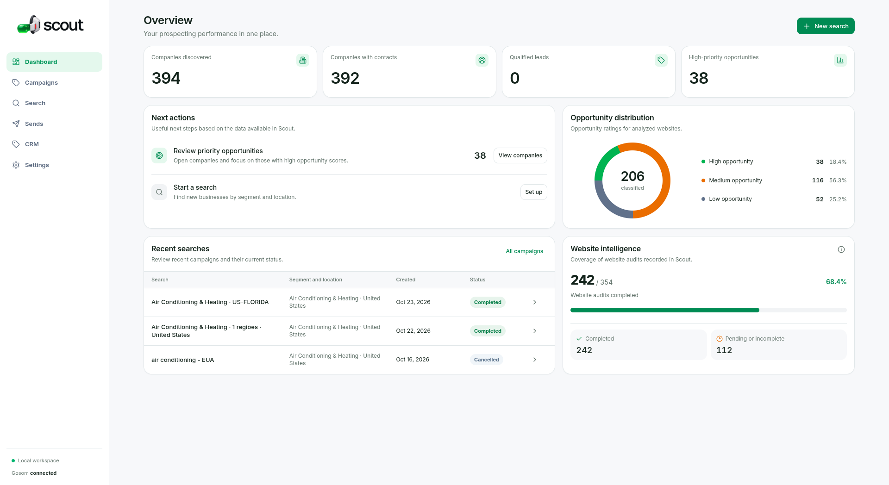

<div align="center">

[English](README.md) · **Português**

<picture>
  <source media="(prefers-color-scheme: dark)" srcset="public/assets/scout-logo-white.png">
  <source media="(prefers-color-scheme: light)" srcset="public/assets/scout-logo-black.png">
  
</picture>

### Encontre empresas. Descubra oportunidades. Inicie conversas.

Um espaço local-first e de usuário único para prospecção B2B: descubra empresas, entenda seus websites, qualifique oportunidades, prepare contatos personalizados e organize o pipeline comercial.


[](LICENSE)

[Por que Scout?](#por-que-scout) · [Funcionalidades](#o-que-o-scout-faz) · [Início rápido](#início-rápido) · [Arquitetura](docs/ARCHITECTURE.md) · [Integrações](docs/INTEGRATIONS.md) · [Segurança](docs/SECURITY.md)



</div>

## Por que Scout?

A prospecção costuma depender de ferramentas separadas para descoberta, pesquisa, qualificação, escrita e acompanhamento. O Scout reúne essas etapas em um ambiente executado localmente, com contexto de campanhas e armazenamento persistente em SQLite. Foi projetado para uma pessoa operando localmente; não é um serviço SaaS hospedado para múltiplos usuários.

## O que o Scout faz

| Funcionalidade | O que acontece | Saiba mais |
| --- | --- | --- |
| Descoberta de empresas | Planeje buscas por país, região ou cidade; o Scout Engine executa jobs de coleta e o Scout importa resultados normalizados e deduplicados. Sua implementação atual usa o Gosom Google Maps Scraper, um componente de terceiros. | [Fluxo de prospecção](docs/PROSPECTING.md) |
| Campanhas e leads | Organize pesquisas salvas, associação de empresas a campanhas, detalhes, filtros e exportação CSV no ambiente local. | [Arquitetura](docs/ARCHITECTURE.md) |
| Descoberta de contatos | Procure dados públicos de contato comercial em websites; um adapter opcional de busca pública pode complementar os resultados. | [Integrações](docs/INTEGRATIONS.md#optional-contact-search) |
| Inteligência de websites | Audite a homepage com Playwright e Lighthouse, armazene evidências e capturas desktop/mobile localmente e pontue sinais de oportunidade disponíveis. | [Integrações](docs/INTEGRATIONS.md#website-audits) |
| Qualificação | Consulte sinais, observações, perfis/pontuações ICP e cohorts salvos usando evidências disponíveis no Scout. | [Fluxo de prospecção](docs/PROSPECTING.md#qualification) |
| Mensagens personalizadas | Gere e edite rascunhos de e-mail vinculados à campanha, usando evidências comerciais salvas e preferências de escrita. | [Integrações](docs/INTEGRATIONS.md#ai-assisted-drafts) |
| Envio controlado | Conecte Gmail ou Zoho, prepare itens na fila de saída e utilize controles de aprovação e envio antes de habilitar a entrega. | [Integrações](docs/INTEGRATIONS.md#email-providers) |
| Pipeline de CRM | Acompanhe etapas comerciais, canais, observações, último contato e atividades das empresas adicionadas ao pipeline. | [Fluxo de prospecção](docs/PROSPECTING.md#6-manage-the-commercial-pipeline) |

## Como funciona

```text
Interface React + Vite
        │ chamadas locais /api
        ▼
API Node.js + Express ─────── SQLite (registros, configurações e filas Scout)
        │
        ├── Scout Engine local (Gosom Google Maps Scraper) ── jobs de pesquisa e CSVs
        ├── Playwright + Lighthouse ── auditorias locais de websites
        ├── Adapter opcional de busca de contatos / bridge Python
        ├── Conexão de IA configurada ── rascunhos de outreach
        └── Gmail / Zoho opcionais ── envio controlado de e-mails
```

O servidor da aplicação coordena integrações e persistência. O frontend não acessa SQLite diretamente. Consulte [Arquitetura](docs/ARCHITECTURE.md) para limites e fluxo de dados.

## Capturas do produto

O Dashboard acima é a única captura do produto incluída nesta primeira publicação.

## Quanto custa?

| Componente | Custos de execução |
| --- | --- |
| Aplicação Scout local | Executada na sua máquina. Hardware, energia e manutenção são de responsabilidade do operador; este repositório não define preço de serviço hospedado. |
| Descoberta de empresas (Scout Engine) | Requer o serviço local Scout Engine, atualmente implementado com o [Gosom Google Maps Scraper, licenciado sob MIT](https://github.com/gosom/google-maps-scraper). Computação e eventuais custos/restrições de uso de terceiros dependem de como e onde ele é executado. O Scout não promete que fontes externas sejam gratuitas ou estejam sempre disponíveis. |
| Auditorias de websites | Usa Playwright/Chromium e Lighthouse localmente. Requer processamento e armazenamento no computador; os websites auditados continuam sendo hosts externos. |
| Descoberta de contatos | A busca baseada em websites é local. Adapters opcionais de busca externa podem exigir credenciais e ter custos do provedor. |
| Rascunhos com IA | Requer conexão de IA configurada e pode estar sujeita a limites, elegibilidade ou cobranças do provedor. Os termos exatos de autenticação externa ainda precisam ser confirmados; veja [notas da integração de IA](docs/INTEGRATIONS.md#ai-assisted-drafts). |
| Provedores de e-mail | Contas Gmail/Zoho e envio estão sujeitos às regras, limites de conta, configuração de domínio e custos de assinatura aplicáveis. |
| Armazenamento local | SQLite, arquivos de jobs do Scout Engine, exportações e capturas de auditoria ocupam espaço no computador. Backups são responsabilidade do operador. |

## Tecnologias

| Camada | Tecnologia | Finalidade |
| --- | --- | --- |
| Interface web | React 19, TypeScript 5.8, Vite 7 | Renderiza a aplicação bilíngue e empacota a interface do navegador. |
| API | Node.js (mínimo declarado: 22.19), Express 5 | Expõe rotas locais e coordena jobs e integrações. |
| Persistência | SQLite por meio de `node:sqlite` | Armazena localmente campanhas, leads, configurações, filas, auditorias e pipeline Scout. |
| Estilos de interface | Tokens CSS, Tailwind CSS 4 / plugin Vite | Os estilos e tokens Scout são o sistema visual principal; Tailwind participa do build. |
| Análise de navegador | Playwright 1.64+, Chromium, Lighthouse 13.5+ | Captura e avalia homepages públicas. |
| Descoberta de empresas | Scout Engine, implementado com Gosom Google Maps Scraper | Executa pesquisas locais e gera arquivos consumidos pelo Scout; o scraper é um componente de terceiros sob MIT. |
| Bridge opcional de contatos | Python 3, `httpx`, Beautiful Soup | Dá suporte ao adapter opcional de busca; não é necessário para abrir a aplicação principal. |

As faixas de dependências declaradas estão em [`package.json`](package.json), e as versões resolvidas são registradas em [`package-lock.json`](package-lock.json). O `.nvmrc` recomenda Node 24.22.2.

## Integrações

| Integração | Finalidade | Requisito |
| --- | --- | --- |
| Scout Engine | Jobs de descoberta de empresas e exportação CSV. A implementação atual utiliza o Gosom Google Maps Scraper, licenciado sob MIT. | Necessário para pesquisas; execute localmente via Docker Compose ou serviço/binário local compatível. |
| Playwright / Chromium | Captura de navegador para inteligência de websites e fluxos relacionados. | Necessário para auditorias; Chromium deve estar disponível. |
| Lighthouse | Análise de performance, SEO, acessibilidade e boas práticas. | Instalado com as dependências Node e usado pelo fluxo de auditoria. |
| Conexão de IA | Geração e tradução de rascunhos. | Funcionalidade opcional; conecte/configure localmente. Os termos de autenticação oficialmente suportados pelo provedor ainda precisam ser esclarecidos. |
| Gmail | Conexão de conta e envio de mensagens aprovadas da fila. | Opcional; requer configuração OAuth no backend e callback. |
| Zoho Mail | Conexão e envio pelo Zoho Mail. | Opcional; requer OAuth ou configuração suportada por senha de app, incluindo a região correta. |
| Busca pública de contatos | Complemento à descoberta de contatos. | Opcional; o template desativa o adapter externo. Provedores selecionados podem exigir credenciais e cobrar pelo uso. |

Configuração detalhada: [Integrações](docs/INTEGRATIONS.md) e [Configuração](docs/CONFIGURATION.md).

## Início rápido

### Requisitos

- Node.js 22.19 ou superior; Node 24.22.2 é a versão recomendada pelo repositório.
- npm compatível com o Node instalado.
- Serviço Scout Engine local para executar pesquisas de empresas.
- Chromium disponível para auditorias de websites.
- Docker Compose é opcional se o Scout Engine for executado por outro método local compatível.

### Instalar e iniciar

```bash
npm ci
cp .env.example .env
```

Inicie o Scout Engine com Docker Compose se for usar a definição de serviço incluída:

```bash
docker compose up -d
```

Depois inicie a API e a interface Scout:

```bash
npm run dev
```

Acesse <http://localhost:5173>. A API local escuta em `127.0.0.1:8787`; o Scout Engine usa `127.0.0.1:8080` por padrão. O `.env.example` pode ser copiado com segurança para uma instalação nova; não coloque segredos em arquivos publicados.

Para parar o Compose sem apagar os dados montados no host, execute `docker compose down`.

Consulte [Instalação](docs/INSTALLATION.md) para alternativas e configuração de navegador.

## Configuração

O backend local lê configurações de `.env` e das Configurações locais. `.env.example` documenta variáveis suportadas e defaults seguros. Nenhum segredo é necessário apenas para abrir a aplicação. Pesquisas requerem Scout Engine; rascunhos com IA e envio de e-mails dependem de suas integrações configuradas.

Os principais controles incluem `GOSOM_URL`, `PORT`, limites de importação, busca opcional de contatos, caminho do Chromium, seleção do provider de IA, chave de criptografia de e-mail, configurações OAuth Gmail/Zoho e a barreira explícita `OUTREACH_SEND_ENABLED`. Mantenha `.env` privado. Consulte [Configuração](docs/CONFIGURATION.md) e [Integrações](docs/INTEGRATIONS.md).

## Segurança e privacidade

O Scout foi projetado para execução local por uma pessoa. Registros e configurações de provedores ficam no SQLite e em arquivos locais relacionados. Credenciais de e-mail conectadas são criptografadas com uma chave fornecida localmente. Credenciais OAuth, arquivos de ambiente, bancos, backups, exportações, capturas de auditoria e dados dos serviços locais não devem ser publicados.

O exemplo desativa o envio externo. O backend exige uma flag explícita, e a aplicação oferece controles de aprovação e pausa/retomada da fila. Revise cada destinatário e mensagem antes de habilitar envios. A execução local não elimina obrigações legais, de privacidade ou segurança. Consulte [Segurança e privacidade](docs/SECURITY.md).

## Limitações conhecidas

- Scout é uma aplicação local de usuário único, não um SaaS público multiusuário.
- Pesquisas dependem do Scout Engine, da rede, do comportamento das fontes e dos termos aplicáveis; resultados e cobertura não são garantidos.
- A inteligência de websites analisa a homepage e não rastreia páginas internas nem envia formulários.
- Encontrar publicamente um endereço de contato não comprova a entregabilidade da caixa postal.
- Geração por IA depende da conexão local, disponibilidade e limites do provedor. Não afirmamos aqui o status exato de suporte externo da autenticação usada.
- Não afirmamos rastreamento confiável de respostas, aberturas, cliques ou atribuição de conversão.
- Python só é necessário para a bridge opcional de busca de contatos. Sua instalação isolada foi validada em uma cópia limpa do projeto, incluindo os 7 testes Python.
- A imagem padrão do Compose usa a tag `latest`; escolha uma versão testada antes de depender de implantações reproduzíveis.

## Uso responsável

Use o Scout somente com fontes e métodos que você está autorizado a acessar. Respeite termos dos provedores, controles de acesso, leis aplicáveis de privacidade e marketing direto, minimização e retenção de dados e solicitações de descadastro. Não use o produto para contornar limites, controles de acesso, CAPTCHA ou restrições de provedores. Revise a precisão e a base legal de mensagens geradas antes de enviá-las. A configuração e operação adequadas das integrações são responsabilidade do usuário.

## Roadmap

Ainda não existe um roadmap público aprovado. Esta seção fica reservada para prioridades revisadas e não representa promessa de funcionalidades ou datas.

## Contribuição

As diretrizes de contribuição ainda não foram publicadas. Antes de propor contribuições, consulte as instruções do projeto em [`AGENTS.md`](AGENTS.md), o [Design System](docs/DESIGN_SYSTEM.md) e as orientações de segurança. Não inclua dados operacionais, segredos, screenshots de auditoria gerados ou checkout local do Scout Engine.

## Licença e créditos

O código original do Scout é disponibilizado sob a [Licença MIT](LICENSE), copyright © 2026 Luanderson Oliveira Miranda Teixeira. Essa licença se aplica ao código de autoria do Scout; ela não substitui licenças ou avisos de dependências, integrações ou materiais de terceiros incorporados. O repositório inclui materiais derivados do Harvey sob MIT em `vendor/harvey` e `skills/harvey`, preservando suas licenças e atribuições de origem; consulte os [avisos de terceiros](THIRD_PARTY_NOTICES.md). Os metadados das dependências também incluem Apache-2.0, BSD, ISC, MPL-2.0, CC-BY-4.0, BlueOak-1.0.0, 0BSD e outras expressões de licença; consulte os arquivos de licença dos pacotes e projetos antes de redistribuir uma cópia empacotada. Uma dependência transitiva do Lighthouse (`sentry@0.50.0`) declara `FSL-1.1-Apache-2.0`; seu código-fonte não está incluído neste repositório, e o aviso registra o pacote para revisão antes da distribuição de uma aplicação instalada ou empacotada. O Gosom Google Maps Scraper é um componente separado sob MIT; os serviços dos provedores mantêm seus próprios termos. As logos oficiais do Scout estão em [`public/assets/`](public/assets/).
